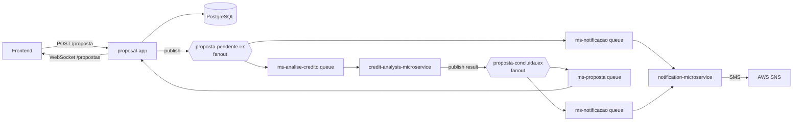

# Proposal App

[](https://github.com/MateuSkywalker90/proposal-app/actions/workflows/ci.yml)

An event-driven credit proposal system built with **Java 17, Spring Boot 3 and RabbitMQ**.

A customer submits a credit proposal (amount + payment term). The proposal is saved and published as an event; a separate service analyzes the credit asynchronously, another service notifies the customer by SMS, and when the analysis is done the result is pushed back to the frontend in real time over WebSocket.

This repository is the **proposal service** — the entry point of the system. It works together with:

| Service | Responsibility |
|---|---|
| **proposal-app** (this repo) | REST API, persistence, publishes proposal events, receives analysis results, pushes updates via WebSocket |
| [credit-analysis-microservice](https://github.com/MateuSkywalker90/credit-analysis-microservice) | Consumes pending proposals and decides approval |
| [notification-microservice](https://github.com/MateuSkywalker90/notification-microservice) | Consumes proposal events and sends SMS notifications through AWS SNS |

> [Built while studying event-driven microservices with Spring Boot and RabbitMQ — based on the course "<course name>". ← keep this line only if it applies; delete otherwise]

## Architecture



### Design decisions

- **Asynchronous messaging instead of REST calls between services.** The proposal service doesn't wait for credit analysis. If the analysis service is slow or down, proposals are still accepted and processed when it comes back.
- **Fanout exchanges.** One event reaches several consumers (credit analysis *and* notification) without the producer knowing who they are. Adding a new consumer means adding a queue, not changing this service.
- **No lost proposals when the broker is down.** A proposal is saved with `integrada = false` and only marked `true` after its event is successfully published. If RabbitMQ is unavailable, the API still accepts the proposal, and a scheduled job republishes pending ones every 10 seconds.
- **Real-time results.** When the analysis result arrives, it's pushed to the frontend over WebSocket (STOMP) instead of making the client poll.

## Tech stack

Java 17 · Spring Boot 3.4 (Web, Data JPA, AMQP, WebSocket) · RabbitMQ · PostgreSQL · MapStruct · Lombok · Docker / Docker Compose

## API

| Method | Endpoint | Description |
|---|---|---|
| `POST` | `/proposta` | Create a proposal |
| `GET` | `/proposta` | List all proposals |

WebSocket topic: `/propostas` — receives a proposal when its analysis is concluded.

Example request:

```json
POST /proposta
{
  "valorSolicitado": 10000.0,
  "prazoPagamento": 24,
  "nome": "Maria",
  "sobrenome": "Silva",
  "cpf": "000.000.000-00",
  "telefone": "+5592999999999",
  "renda": 5000.0
}
```

> Field names are in Portuguese (`valorSolicitado` = requested amount, `prazoPagamento` = payment term in months).

## Running locally

**Requirements:** Java 17, Maven, Docker.

```bash
# 1. Build the jar (also runs the unit tests)
./mvnw clean package

# 2. Build the image and start the app, RabbitMQ and PostgreSQL
docker compose up -d --build
```

- API: http://localhost:8080/proposta
- RabbitMQ management UI: http://localhost:15672 (guest / guest)

To run the full flow, also start `credit-analysis-microservice` and `notification-microservice` against the same RabbitMQ.

> Credentials in `application.properties` and `docker-compose.yaml` are local development defaults only.

## Tests and CI

Unit tests (JUnit 5 + Mockito) cover the publish/retry logic and the concluded-proposal listener. GitHub Actions builds the project and runs the tests on every push.

```bash
./mvnw test
```

## Known limitations / next steps

Being honest about what's not done yet:

- [ ] Integration tests against real RabbitMQ and PostgreSQL (Testcontainers)
- [ ] Dead-letter queue is declared but not yet attached to the pending-analysis queue
- [ ] Input validation (`@Valid`) and error handling on the API
- [ ] Move credentials to environment variables
